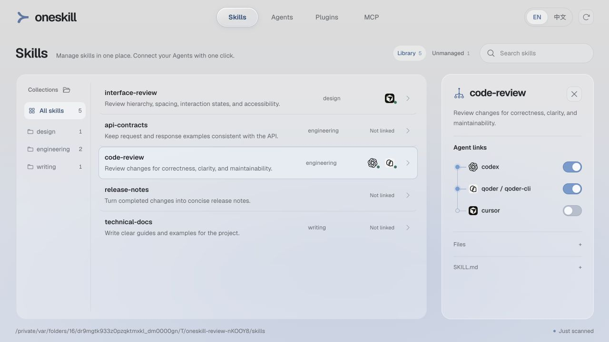
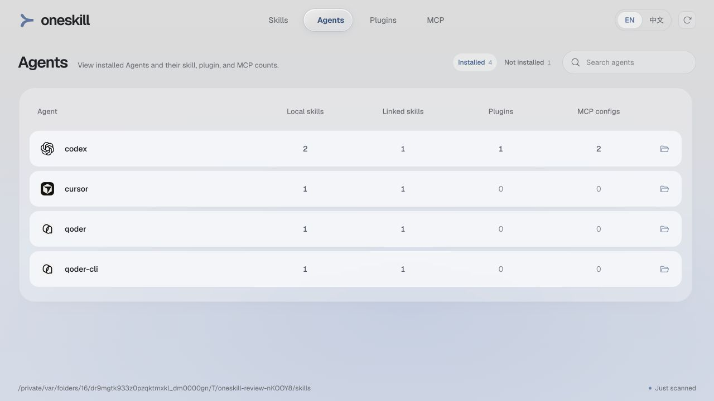

# oneskill

**统一管理 Skill，Agent 一键链接接入。**

[English](README.md) · **简体中文**

oneskill 是面向编程 Agent 的本地 Skill 管理工具。将共享包集中存放，用文件夹组织内容，再通过符号链接接入各 Agent 目录，减少重复维护和版本不一致的问题。

## 功能

- **共享管理库**：按目录浏览和搜索 Skill，查看 `SKILL.md`，调整各 Agent 的接入关系。
- **迁移与链接分开管理**：将已有 Skill 移入管理库，保留备份并检查冲突，再按需连接 Agent；需要留在原位置的包可以忽略。
- **本地资源概览**：查看 Agent 安装状态，以及已发现的 Skill、插件和 MCP 配置。
- **三个入口，一个工作区**：Web、CLI 和 Codex 插件共用数据与操作。Web 和插件使用相同的响应式界面，支持中英文。
- **保留普通文件**：无需云端账号或数据库，管理库始终是本地文件夹中的 Skill 包。

## 界面预览

**Skills 管理库与 Agent 接入关系**



**Agent 概览**



## 安装

需要 **Node.js 20+** 和 npm。Web 界面需要浏览器；Codex 集成需要支持本地插件和 MCP Apps 的桌面客户端。

```bash
git clone https://github.com/zyfn/oneskill.git
cd oneskill
npm ci
npm --prefix web ci
npm run build
```

## 使用方式

### Web

```bash
npm start
```

macOS 也可以双击项目目录中的 `oneskill.command`。

手动打开界面时，请复制终端输出的完整访问链接。仅输入本机地址和端口，无法为新的浏览器会话完成授权。

1. **添加 Skill**：将包含 `SKILL.md` 的包放入 `~/.oneskill/skills/`，或在 **Skills → 未管理** 中选择 **纳入管理**。纳入管理会迁移原包并保留备份，原位置清空，不会自动链接任何 Agent。点击 **选择** 可在当前列表中批量纳入、忽略或恢复，保留搜索与来源筛选。
2. **整理目录**：在 `skills/` 下建立文件夹。移动已链接的包后，扫描会提示失效链接，可选择新位置重新链接，或仅移除失效链接。目录树保留嵌套层级；**全部 Skills** 包含根目录和所有子目录中的包。
3. **接入 Agent**：选择 Skill 后，在详情中切换 Agent 链接开关。写入相同目录的 Agent 共用一条链接；从其他位置读取到的链接显示为只读状态，可在提示中查看来源。
4. **处理未管理的包**：列表展示管理库外的独立包，以及来源 Agent 或共享目录。多个 Agent 共用的目录只列一次；指向管理库的软链接属于已有引用，不重复列为未管理的 Skill。**忽略** 只隐藏列表项，不修改文件；通过 **已忽略 → 恢复** 可重新显示。
5. **编辑共享源文件**：打开 Skill 文件夹并直接修改。已接入的 Agent 读取同一份包，具体重载和发现时机遵循 Agent 自身的规则。

**Agent** 页面区分已安装与未安装。**插件**和 **MCP** 使用独立页面，以小卡片展示只读清单，支持搜索和按 Agent 筛选。多个 Agent 共用的配置根目录在全局数量中只计一次，并显示在组合筛选项下。MCP 数量包含 Agent 配置和插件声明；同一插件范围内重复的声明合并统计，不同插件保持独立。这些数量可能包含未启用的声明，不代表当前连接数。

### CLI

CLI 默认输出 JSON，连接与界面相同的本地服务：

```bash
npm run cli -- workspace
npm run cli -- workspace --refresh
npm run cli -- skills
npm run cli -- agents
npm run cli -- plugins
npm run cli -- mcp-inventory
```

使用工作区返回的标识调用具体操作：

```bash
npm run cli -- call getSkill '{"skillId":"managed:engineering/code-review"}'
npm run cli -- call setSkillLink '{"agentId":"agent:codex","skillId":"managed:engineering/code-review","linked":true}'
```

修改操作未提供请求标识时，`call` 会自动生成。完整命令见 `npm run cli -- help` 和[操作参考](docs/reference.zh-CN.md)。

### Codex 插件

完成项目构建后，打包并安装本地插件：

```bash
npm run build:plugin
codex plugin marketplace add ./dist/marketplace
codex plugin add oneskill@oneskill-local
```

重启桌面客户端，在左侧导航或更多应用菜单中打开 **oneskill**。插件提供相同的管理界面，也通过 MCP 工具在对话中提供工作区操作。入口位置由宿主客户端决定。

安装包包含服务代码、界面和 Agent 清单，需要 `PATH` 中可用的 Node.js，启动时不安装依赖或构建前端。更新源码后，重新构建界面与插件包、安装插件，并重新加载桌面客户端以使用新版。

### 指定工作区

所有入口默认使用 `~/.oneskill`。管理库存放在其他位置时，为每个入口指定**同一个绝对目录**：

```bash
npm run cli -- web --open --workspace /absolute/path/to/workspace
npm run cli -- skills --workspace /absolute/path/to/workspace
npm run build:plugin -- --workspace /absolute/path/to/workspace
```

插件选择工作区后，需要安装生成的包。工作区数据独立于源码目录和插件缓存保存。

## 运行原理


1. **发现 Agent**：按当前操作系统加载 Agent 定义，检查声明的命令与路径。CLI 只有在 `--version` 成功退出并返回可识别版本时才算检测通过；桌面应用和扩展检查安装信息。配置目录本身不证明 Agent 已安装。
2. **读取资源**：扫描管理库和已配置的 Agent 目录，生成共享工作区快照。页面可见期间会轮询工作区，超过 30 秒的快照会重新扫描；也可手动立即扫描。页脚展示扫描时间与读取诊断，数量代表扫描范围内已发现的条目。
3. **统一执行操作**：Web 通过带鉴权的本地 HTTP 访问服务，CLI 与 MCP 适配器连接同一服务。所有入口共用参数校验和错误模型；写入排队执行，目标目录加锁，写入完成后先记录成功回执，再独立刷新清单。扫描失败不会把已成功写入误报为失败。
4. **保留文件结构**：链接操作在配置的 Agent 目标目录中建立指向管理库的符号链接；取消链接只移除该引用，保留共享源包。纳入管理时校验库中的副本、备份原包，原位置不再保留 Skill 或自动创建链接；之后通过 Agent 开关按需连接。遇到不同内容不会覆盖。

多个 Agent 可能读取同一个共享目录，因此一条物理链接可能对多个 Agent 可见。界面会反映这一关系；其他扫描目录中的链接只展示为可用来源，不伪装成可以独立开关的接入关系。

服务仅监听 `127.0.0.1`，面向本机单个用户。访问凭证、服务信息、锁和请求记录与管理库分开存放。写入中断后不会盲目重放，请先重新扫描并检查文件，再决定是否重试。

## 工作区与 Agent 配置

```text
~/.oneskill/
├── skills/
│   ├── engineering/
│   │   └── code-review/SKILL.md
│   └── writing/
│       └── technical-docs/SKILL.md
├── agents.local.json      # 可选的 Agent 定义与覆盖项
└── skills.ignore.json     # 持久保存的忽略选择
```

内置 [Agent 清单](agents.catalog.json) 声明命令、图标、macOS 和 Windows 配置目录及资源读取规则。在工作区创建 `agents.local.json`，即可新增 Agent 或覆盖预设，然后重新扫描：

```json
[
  {
    "name": "example-agent",
    "commands": ["example-agent"],
    "configDir": {
      "macos": "~/.example-agent",
      "windows": "${USERPROFILE}/.example-agent"
    },
    "skillDir": "skills"
  }
]
```

相对资源路径基于当前系统选定的配置根目录。已有 JSON、JSONC、TOML 和插件清单读取器可通过配置复用；新的私有格式仍需实现对应扫描器。支持范围见 [Agent 扫描说明](docs/agent-discovery.md)和[参考文档](docs/reference.zh-CN.md)。

检测到 Agent 安装不代表支持它的全部资源格式。Skill 加载及多级目录支持遵循各 Agent 的规则。Windows 可能需要开发者模式或相应的符号链接权限，原生桌面行为仍需按平台验证。

## 开发与贡献

```bash
npm run dev          # 本地服务与构建后的界面
npm run check        # 语法检查、测试与两个界面的构建
```

前端热更新时，先启动本地服务，再将 Vite 指向终端输出的服务地址：

```bash
ONESKILL_ENDPOINT=http://127.0.0.1:PORT npm run dev:web
```

Node.js 运行时与文件操作位于 `src/`，React、Vite 和 Tailwind CSS 界面位于 `web/src/`。模块边界见[架构说明](docs/architecture.md)。扫描器变更请提供脱敏测试样本，界面变更请检查中英文，并运行 `npm run check`。

## 许可证

[MIT](LICENSE)。Agent 名称及 Logo 归各自所有者所有。
